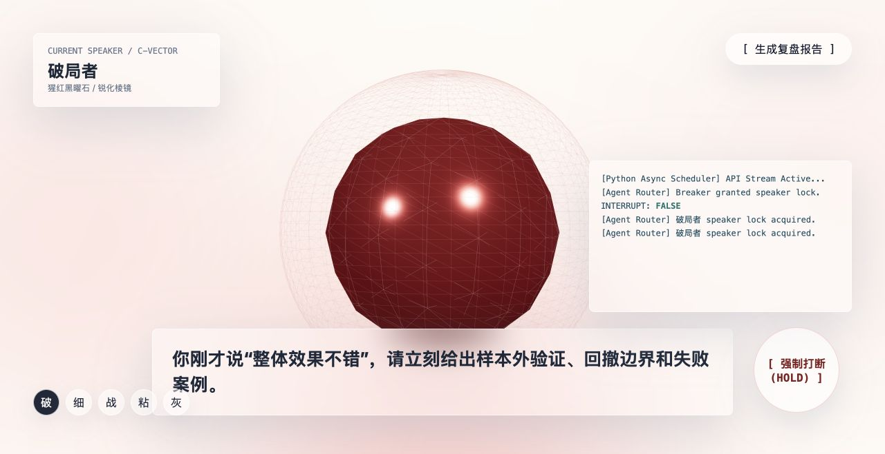

# 翎语智面 | Lingo AI Interview



沉浸式多 AI 考官面试交互原型。以米白玻璃界面、差异化 3D 考官和高压交锋流程，探索更具临场感的面试演练体验。

## 体验流程

系统初始化 → 能力维度自评 → 面试环境配置 → 多考官群面演示 → 复盘报告。

- 四维能力滑块与实时 SVG 雷达图。
- 五位独立视觉考官：破局者、细节控、战略家、粘合剂、灰犀牛。
- Three.js 几何建模、柔和悬浮动画与 Web Audio 频域联动。
- 考官切换、逐字字幕、按住强制打断及状态日志。
- 自评与示例实测对照雷达、复盘建议，以及浏览器打印 / 另存为 PDF。

## 本地运行

直接用现代浏览器打开 [`outputs/lingo-ai-interview.html`](outputs/lingo-ai-interview.html) 即可。推荐桌面端 Chrome 或 Edge，并启用 WebGL。

也可以在仓库目录启动静态服务：

```sh
python3 -m http.server 8000
```

然后访问 <http://localhost:8000/outputs/lingo-ai-interview.html>。

## 技术与边界

单文件 HTML，内含原生 CSS、JavaScript 与 SVG；通过 CDN 加载 Three.js r128 和 GSAP 3.12.5，因此首次打开需要联网，无需构建或 API Key。

当前版本为前端演示，不是已接入大模型的生产系统。考官发言、调度日志和评估报告使用示例数据；音频分析使用本地合成信号展示联动，不采集麦克风，也未接入真实语音识别、语音合成、LLM API 或后端多智能体服务。时长选项仅用于演示配置，不代表已实现完整计时面试。

## 文件

| 路径 | 内容 |
| --- | --- |
| `outputs/lingo-ai-interview.html` | 完整网页原型 |
| `docs/cover.jpg` | 浏览器实际运行截图，README 封面 |

封面来自项目实际页面，并非概念渲染图。
